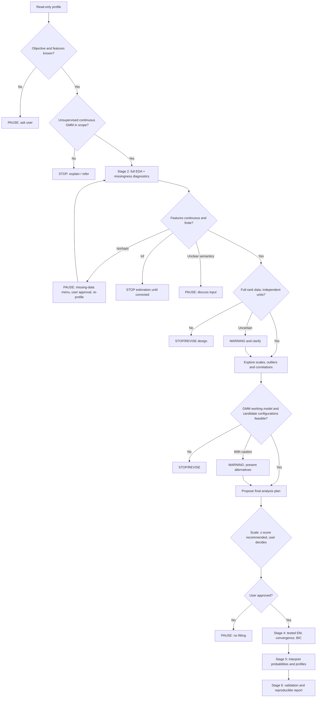

# GMM Statistical Decision Tree — v1.4 (Stages 1–3; Stages 4–6 by reference)

> **v1.4 (2026-11-07), user-confirmed changes from v1.3:**
> (1) Stage 2 must run the full EDA.
> (2) Missing data go through a user-selected menu: complete-case, mean, median, KNN or diagnostics only.
> (3) Every deletion, imputation or standardization requires explicit user approval.
> (4) Inf/−Inf block model estimation; NA/NaN enter the missing-data workflow.
> (5) Stage 3 recommends z-score standardization by default but never forces it.
> (6) The Stage 1–6 structure and the planned EM and BIC/AIC procedures are unchanged.
>
> Items still awaiting review are listed in [`decision-tree-alignment.md`](decision-tree-alignment.md). Their v1.3 wording below remains in force.

> Status: Stages 2–3 are implemented in R (`scripts/data_stage2.R`, `scripts/eda_stage2.R`, `scripts/feasibility_stage3.R`); Stages 4–6 are design specifications. Scope: unsupervised Gaussian mixtures. **Model estimation** requires complete, finite, continuous observations. Incomplete data are handled beforehand in Stage 2, by a method the user selects and approves. Based on the six-stage structure of Hair et al., *Multivariate Data Analysis*, 8th ed., Chapter 4. The GMM-specific rules are project design decisions, **not** quoted rules from Hair.

## Interaction contract (adapted from categorical-association example)

1. **Profile first**: inspect input read-only, report all columns, n, missingness and tentative variable types. If the research objective is not already specified, **pause and ask one question about the objective**.
2. **Full Stage 2 EDA (required, v1.4)**: after variables are identified, always run the Stage 2 EDA **for exploration only**, whether or not data are missing:
   - descriptive statistics;
   - histograms with density, and boxplots;
   - a scatterplot matrix;
   - Pearson/Spearman correlations;
   - basic collinearity checks (zero variance, rank, condition number, VIF).

   Missingness charts do not replace the EDA. (Whether a PCA visualization is also required is pending review, item A4.)
3. **Statistical decision and user approval**: apply this decision tree and `checklist.md`; summarize proposed variables, excluded rows (if any), transformations, candidate G, covariance model, initialization and limitations. **Every deletion, imputation or standardization requires explicit user approval (v1.4)**. **Pause until explicit user approval** before fitting. If the user originally specifies a complete approved configuration, don't ask again just to repeat it; provide the audit and confirmation gate consistent with the class project design.
4. **Computation** (future): invoke existing tested R scripts; never invent estimates. Save specifications, diagnostics and artifacts.
5. **Interpretation and reproducibility** (future): explain results based on generated files, with caveats; save a reproducible R command or Quarto report.

## Six statistical stages

### Stage 1: Objectives of cluster analysis

**Q1** Is the task to describe potential latent groups (model-based clustering) or approximate a continuous multivariate density?  
- **YES** → proceed. Group interpretation is exploratory; neither G>1 nor real-world distinct groups are guaranteed.
- **UNCLEAR** → **PAUSE**; clarify whether the user wants unsupervised clustering, density estimation, or prediction from known labels.
- **NO** (purely supervised classification, purely categorical latent classes, longitudinal/repeated-measure mixture, mixture regression) → **OUT OF SCOPE**, explain suitable alternatives; do not silently fit GMM.

**Q2** Are observation units, variables and any known labels identified?  
- **YES** → record analysis question, `row_id`, selected continuous variables; external labels only for post-hoc assessment unless a different model is requested.
- **NO** → **PAUSE** for the minimum necessary user clarification. Never infer measurement scales solely from numeric coding.

### Stage 2: Research design

**Q3** Are candidate features genuinely continuous and numeric?  
- **YES** → continue.
- **UNKNOWN** (e.g., integer code 1/2/3, Likert item) → **PAUSE** to confirm semantics and reconsider model fit.
- **NO** (nominal or ordinal) → **STOP the current fit**; recommend a more appropriate family or request different features. Do not arbitrarily recode categories as continuous.

**Q4** Are all selected analysis entries finite (not NA, NaN or Inf)? (v1.4)  
- **YES** → continue.
- **NA/NaN present** → **PAUSE / BLOCK FIT** and enter the missing-data workflow (`missing-data-menu.md`):
  1. Report missingness by variable and pattern, and list any all-missing rows.
  2. Present the menu: **complete-case, mean, median, KNN (user-chosen k) or diagnostics only**.
  3. Run nothing until the user chooses and approves.
  4. Record removed rows and imputed cells, then re-profile, including the EDA on the processed data.

  Multiple imputation and missing-data EM are not available in v1.4. The user may also supply an externally prepared complete dataset.
- **Inf/−Inf present** → **STOP model estimation** for this dataset. Inf is invalid data, not missingness. Report the affected cells; diagnostics may still run, but no processing or fit can proceed until the values are corrected and their provenance recorded.

**Q5** Are there constant columns, exact linear dependencies or duplicate columns?  
- **YES** → **BLOCK FIT** for unconstrained full covariance; show affected columns and propose variable revision; re-profile after change.
- **NO** → continue. Severe near-collinearity triggers **WARNING** and a numerical-stability review; do not automatically drop variables.

**Q6** Do scales, outliers, duplicates, and selection of variables require discussion?  
- **YES** → **WARNING / PAUSE for any impactful change**.
  - Scale (v1.4): Stage 3 **recommends z-score standardization by default**. The user may keep original units, and the choice is never forced. No transformation is applied until the user approves; the parameters are recorded for back-transformation.
  - Report unusual observations; do not delete them.
  - Duplicate rows may be valid observations, not necessarily bad data.
- **NO** → continue.

**Q7** Is the row independence and sampling context understood?  
- **YES** → document observational unit and generalizability limits.
- **UNKNOWN** → **WARNING + ask user**; row independence cannot be established purely by looking at CSV.
- **KNOWN DEPENDENCE** (repeated observations or clustered units not accommodated by model) → **STOP standard independent-row GMM** and explain alternatives or obtain a redesigned independent-unit dataset.

### Stage 3: Model assumptions & feasibility

**Q8** Is a Gaussian mixture a reasonable *working* model for the selected features?  
- **YES** → continue.
- **UNCERTAIN** → **WARNING** and explain Gaussian component assumption, possible skew, tails and poor fit; do not demand global multivariate normality.
- **NO** → **STOP / refer** to suitable distributional alternatives if the user does not accept its limitations.

**Q9** Is the proposed G and covariance structure computationally feasible?  
- For full-covariance p-dimensional GMM the free-parameter count is `k = (G-1) + G*p + G*p*(p+1)/2` (unconstrained, ignoring regularization).
- Do **not** claim that `n > p` alone ensures each component has sufficient information; effective component membership, spread and positive definiteness matter.
- If G unspecified, propose a **feasible** search range, initially 1–5 only as a candidate default; verify against n, p, model complexity and practical computation.
- **PASS**: candidate models can be attempted with numerical checks.
- **WARNING**: weak sample-to-parameter ratio or sparse proposed components; shrink range, change covariance structure or gather more data only with user approval.
- **STOP**: requested candidate cannot be estimated under full covariance with the current data and has no approved revision.

**Q10** Have all decisions affecting analysis been documented and approved?  
- **YES** → write `spec.json` and allow future Stage 4.
- **NO** → **PAUSE, DO NOT FIT**. Report a concise proposed plan and outstanding decisions.

### Stage 4: Derive clusters & assess fit (design specification complete)

Follow **[`stage4-model-fitting.md`](stage4-model-fitting.md)** and **[`stage4-checklist.md`](stage4-checklist.md)**. Separate model configuration, multi-start EM, validity/convergence diagnosis, and BIC/AIC model selection. Only compare valid comparable fits; no valid candidate means STOP and diagnostic-only output. Stage 4 is specified but **not yet implemented in R**.

### Stage 5: Interpretation

- Report weights, means, covariance structures, posterior assignment probabilities, MAP labels and uncertainty.
- If standardized, return profiles also in original units when mathematically justified; do not mislabel components as verified real-world classes.
- If selected G=1, report that no multiple-component solution was preferred among candidates.

### Stage 6: Validation and profiling

- Check random-start stability; consider variable/scaling/model-range sensitivity, model misfit, tiny components, and overlap.
- Optional external labels are used for post-hoc comparison only.
- Save an audit trail, warnings, reproducible commands, report, figures and tables.

## Compact flowchart

## Source boundary

This Skill uses Hair Chapter 4 (8th ed., pp. 199–229) as a reference framework and extends it for GMM; the stages are adapted, not identical to Hair's. Hair Chapter 4 supports the *six stages*, research objective/variable choices, standardization and outlier awareness, representativeness and multicollinearity, model-based clustering and interpretation/validation. Normality: Hair (p. 211) states that normality has little bearing on cluster analysis in general (distance-based methods); a GMM, by contrast, assumes multivariate normal *components*, so the Gaussian working-model checks in Stage 3 are GMM-specific design choices, not Hair's rules. Numerical GMM feasibility formulas, implementation approvals, missing-data scope, execution safeguards and R/Claude Code orchestration are **additional Skill design choices**.
