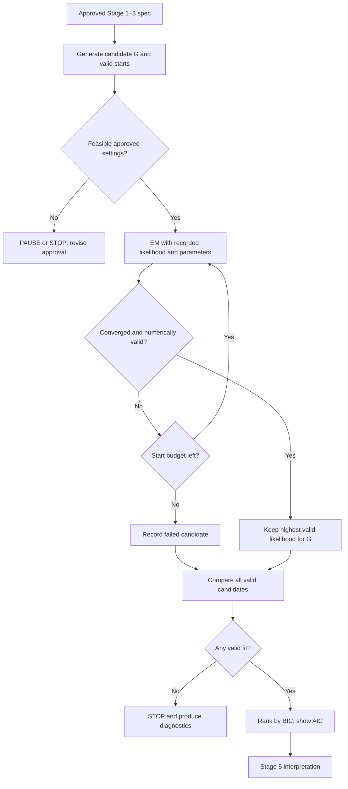

# Stage 4 — Deriving Clusters and Assessing Overall Fit

> **Implementation status (2026-11-07):**
> - 4A–4B (configuration, multi-start EM) are implemented in `scripts/em_stage4.R`; the formulas are verified in [`stage4-em-math.md`](stage4-em-math.md).
> - 4C (convergence diagnostics) and 4D (BIC/AIC selection) are implemented in `scripts/select_stage4.R`. Additional heuristic thresholds are recorded in its `convergence_summary.json` and listed as pending in `decision-tree-alignment.md` (B10).
> - Optional convergence confirmation is implemented in `scripts/confirm_stage4.R`. It replays every valid start and continues it under a stricter tolerance. It is diagnostic only: default tol stays 1e-6, and a better solution enters the analysis only through a new Stage 4 fit plus `register-model` and user-approved `activate-model`.
> - A refit with other numerical settings runs through the workflow's sensitivity commands (`scripts/sensitivity_workflow.R`): an approved plan, a fit into `sensitivity/<plan_id>/fit`, the confirmation when tol > 1e-8 (otherwise `NOT_RUN`, which is not a pass), validation, candidate registration and a descriptive comparison. The active model changes only through `activate-model --approved true`. G stays within the Stage 3 candidates; initialisation is that of the active model unless the plan sets `--init`.
> - Initialisation (`em_init`, F9): `kmeans` (default), `random` (balanced hard partition), `random-soft` (each row's responsibilities ~ Dirichlet(1,...,1); project heuristic, pending review) and `ward` (one deterministic start: ward.D2, Euclidean, approved row order, ties resolved by `hclust` from that order, no jitter). Each only produces responsibilities for one unchanged M-step. A plan uses one method; `random-soft` and `ward` are reachable in a workflow only through an approved plan. Each start records `init_method`, `init_detail`, `seed`, `rng_kind`, status, reason, minimum effective n, maximum condition number and minimum eigenvalue. See the likelihood warning in 4C.4: a higher likelihood from another initialisation is not evidence of a better model.
> - The text below remains the governing specification.

**Status:** design specification. Connects to the approved Stage 1–3 analysis specification. Based on Hair et al. (8th ed.) Chapter 4's Stage 4 and pp. 226–227 description of model-based clustering, EM, posterior probabilities, and BIC; details below are **additional GMM engineering decisions**, not direct prescriptions by Hair.

## 4A. Model configuration

**Preconditions**: Stage 1–3 `approved_for_fit=true`; approved features and preprocessing fixed; independent continuous finite rows; full-rank selected feature matrix for full-covariance v1.

1. Decide if user wants fixed `G` or selection over a candidate set. The suggested initial set is `1:5`, **not a theoretical default**; reject invalid values (G<1, G>n) and warn if large relative to n,p.
2. V1 covariance form: **component-specific full positive-definite matrices**. Do not implicitly compare a model with a different covariance constraint. Alternative covariance families are a planned extension requiring a separate spec and revised parameter-count formula.
3. For full covariance in p dimensions the nominal free parameter count is `k_G=(G-1)+G*p+G*p*(p+1)/2`. Report it for each candidate. Parameter count does not establish estimability by itself.
4. Suggested initial settings (to be validated in testing): `n_init=20`, `max_iter=1000`, `relative_tol=1e-6`, `seed=421`. Record exact package/runtime and numeric safeguards; these are project choices.
5. Initialization must produce strictly positive weights, finite means and positive-definite covariances. Use reproducible multiple random/hierarchical starts; record each. A failed start counts as a failure, not as a zero-likelihood candidate.
6. Do not apply undocumented scaling, row deletion, regularization or covariance replacement. Any altered preprocessing or substantive model family requires an updated approval gate.

**Decision**: `PASS` when requested candidates and safeguards are supported; `WARNING` when sample/effective group sizes or conditioning suggest instability; `PAUSE` when new user choice required; `STOP` when no viable approved configuration exists.

## 4B. EM estimation

For observation x_j and component i, responsibilities:

`tau_ji = pi_i * phi_p(x_j | mu_i, Sigma_i) / sum_h pi_h * phi_p(x_j | mu_h, Sigma_h)`.

Use log-density + log-sum-exp to avoid underflow. The unrestricted full-covariance update is:

`N_i=sum_j tau_ji`, `pi_i=N_i/n`, `mu_i=sum_j tau_ji*x_j/N_i`,

`Sigma_i=sum_j tau_ji*(x_j-mu_i)(x_j-mu_i)^T/N_i`.

Use correct old/new responsibilities and updated mean at the M-step; do not reuse stale mean or normalize covariance by `N_i-1`. For `G=1`, a direct one-component Gaussian MLE is acceptable and should be included in the candidate comparison.

Track at least: start ID, iteration, observed-data log-likelihood, convergence code, weights, component effective memberships, covariance diagnostics and reason for failure. Reject nonfinite likelihood and invalid parameters. For each G, retain the highest-log-likelihood **valid converged** run. Distinguish numerical optima across starts; do not claim global maximality.

## 4C. Convergence, degeneracy & numerical checks

1. Check `loglik_t` finite on every iteration; allow small **numerical** decreases but record them and flag material monotonicity violations. With exact unconstrained EM under valid arithmetic log-likelihood should be non-decreasing.
2. Suggested stopping criterion: `abs(ll_t-ll_(t-1))/(1+abs(ll_(t-1))) < 1e-6` after a full E/M step; implementation must clearly document whether likelihood is computed before or after updates. Hitting `max_iter` without convergence is `NOT_CONVERGED`, not automatically valid.
3. Require `pi_i>0` and effective membership `N_i>0`, all finite. Check each Sigma_i for positive eigenvalues/Cholesky success and acceptable conditioning. **No universal eigenvalue/condition-number cutoff** is declared in v1; record scale-aware checks and calibrated thresholds in later testing.
4. A component collapse or covariance approaching singularity is especially important: the unconstrained Gaussian mixture likelihood can become unbounded. A large log-likelihood alone is **not** evidence of a good fit.
5. If a run fails, attempt another already-approved initialization up to the fixed start budget; don't silently change data, component count or covariance constraints. When all starts fail, mark that G as `FAILED`.
6. If covariance regularization is introduced later, identify it as a different estimation specification and compare models only under a documented, consistently applied objective and selection rule.

Suggested run status: `CONVERGED_VALID`, `NOT_CONVERGED`, `DEGENERATE`, `NUMERIC_ERROR`, `INVALID_START`.

## 4D. Model selection

For candidate G with **valid** convergence, compute:

`AIC = -2*loglik + 2*k_G`

`BIC = -2*loglik + log(n)*k_G`.

This convention means **smaller is preferred**. `mclust` typically defines its own BIC as `2*loglik-k_G*log(n)` (larger is preferred). Never mix these without sign conversion. Only compare models using the same observations, selected variables, preprocessing, likelihood convention and appropriately counted parameters. If preprocessing differs, flag comparisons as non-comparable; do not rank them as if on one common likelihood basis.

Decision tree:
- **At least one valid fit**: rank valid candidates by BIC (primary), display AIC and log-likelihood as context, note candidates that failed. Optionally show posterior uncertainty as a diagnostic, not as a replacement for BIC.
- **BIC selects G=1**: explicitly report no multicomponent model was preferred *among evaluated candidates*; do not force `G>=2`.
- **All fits fail**: `STOP`, return diagnostic report; require changes and approval prior to rerun.
- **Near-ties, boundary optimum or unstable solutions**: `WARNING`; report uncertainty and request Stage 6 sensitivity, not unconditional certainty.

## Hand-off to Stage 5

Required outputs: `approved_spec.json`, `fit_status.csv`, `model_selection.csv`, `selected_model.rds`, `loglik_history.csv`, `parameters.csv` (or structured JSON), `posterior_probabilities.csv`, `warnings.json` and `session_info.txt` (names provisional). For `G=1`, posterior values are 1; clusters should not be portrayed as discovered segmentation. Do not fabricate files absent from the implementation.

## Stage 4 compact decision flow

## Pending validation questions

- Initialization method, deterministic seed scheduling, and potential initialization constraints.
- Exact convergence rule and monotonicity tolerance under floating-point arithmetic.
- Positive-definite/condition checks and safeguards for near-singular mixtures (with empirically validated thresholds).
- Whether/how to offer common vs component-specific covariance constraints in v2.
- Which numerical tolerance is acceptable when comparing to `mclust` after aligning initializations, constraints, BIC sign and label permutations.

**Cross-stage execution statuses:** see [`stage-contract.md`](stage-contract.md). Candidate failure is distinct from failure of all candidates; criteria for invalid candidates must be NA, never an artificial finite BIC.
